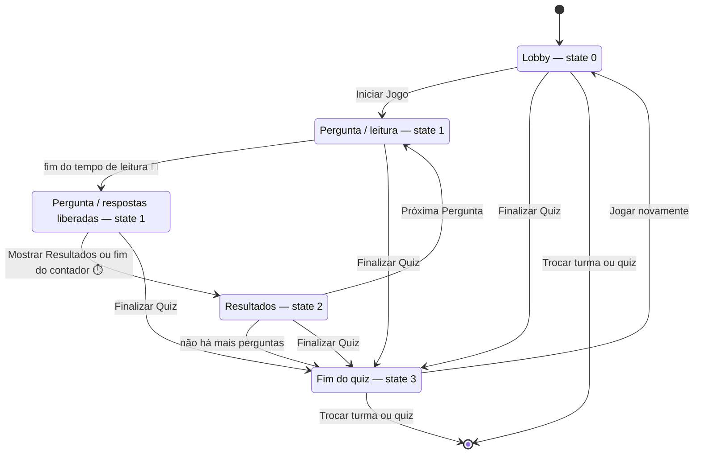

# quiz_ufpa

Uma ferramenta interativa inspirada no Kahoot, desenvolvida para dinamizar o
aprendizado de conceitos de Inteligência Computacional e Processamento de Sinais.
O professor controla a partida em tempo real e os alunos respondem pelo celular
ou notebook, tudo pela rede local.

## Como iniciar

Você precisa ter o **Python 3** instalado. Clone o repositório e instale as
dependências:

```sh
git clone https://github.com/lasseufpa/quiz_ufpa.git
cd quiz_ufpa
pip install -r requirements.txt
```

Depois, inicie o servidor:

```sh
python app.py
```

Na **primeira execução**, o navegador abre automaticamente na tela de
**configuração inicial**, onde você define a senha do professor. Se ele não
abrir, acesse `http://localhost:5000/setup`. Nada é digitado no terminal.

Ao iniciar, o terminal mostra os endereços a usar:

```
Aponte seu navegador de host (professor) para: http://localhost:5000/host
Aponte seu navegador de admin para: http://localhost:5000/admin
Alunos devem acessar: http://10.10.20.163:5000
```

> O endereço dos alunos usa o IP da sua máquina na rede local — todos precisam
> estar na **mesma rede**.

## Rodar com Docker (sem instalar nada)

Se você só vai **usar** o sistema (não vai mexer no código), esta é a forma mais
fácil: não precisa instalar Python nem as dependências.

Você só precisa do [Docker](https://docs.docker.com/get-docker/) — no Windows e
no macOS, o Docker Desktop já vem com tudo.

Na pasta do projeto, execute:

```sh
docker compose up --build
```

Na primeira vez ele baixa e monta tudo (leva alguns minutos). Depois abra
`http://localhost:5000/setup` e defina a senha do professor — não é preciso
digitar nada no terminal. Em seguida:

- **Apresentador:** `http://localhost:5000/host`
- **Administração:** `http://localhost:5000/admin`
- **Alunos:** o IP da sua máquina na rede local (aparece no terminal)

**Para parar:** `Ctrl+C`. Para subir de novo depois: `docker compose up -d`.
Para encerrar de vez: `docker compose down`.

Seus dados ficam no computador, fora do container: quizzes, figuras, alunos,
senhas e os CSVs de resultado continuam lá mesmo se o container for apagado.

> **No macOS/Windows**, o `docker-compose.yml` usa `network_mode: host`, que
> funciona bem no Linux. Se os alunos não conseguirem abrir o endereço, troque
> essa linha por `ports: ["5000:5000"]` (há o exemplo comentado no arquivo).

**Para usar outra porta:** `QUIZ_PORT=8080 docker compose up`.

## As telas

| Tela | Endereço | Para quê serve |
|------|----------|----------------|
| **Aluno** | `http://<ip>:5000` | Informar o nome e responder (quando a sala está aberta) |
| **Apresentador** | `http://localhost:5000/host` | Conduzir a partida (pede senha) |
| **Administração** | `http://localhost:5000/admin` | Cadastrar os alunos de cada turma (pede senha) |
| **Editor** | `http://localhost:5000/editor` | Criar turmas, quizzes e copiar quizzes entre turmas |
| **Guias** | `http://localhost:5000/guia` | Tutoriais de uso de cada tela |

A senha do apresentador e da administração é a mesma: a que você definiu na
primeira vez que abriu o sistema.

Dentro da tela do apresentador há dois botões no canto superior esquerdo:

- **☰** — abre o menu lateral, com atalhos para os guias de uso e para as
  outras telas (sempre em outra aba, para não pausar a partida).
- **?** — abre direto o guia do apresentador.

Os guias também ficam em `http://localhost:5000/guia`, em abas: apresentador,
editor, administrador e aluno. Cada aba mostra só o tutorial escolhido, e
`/guia#editor` (por exemplo) abre direto naquela aba.

## Turmas

Um professor pode ter **várias turmas**. Cada turma tem:

- a **sua própria lista de alunos**;
- os **seus próprios quizzes** (pastas separadas, um quiz não aparece na turma
  de outra pessoa por engano);
- os **seus próprios resultados** (o CSV final leva o nome da turma).

Criar, renomear e excluir turmas é feito na tela *Editor*, na primeira linha:

- **Nova turma** — dá um nome (ex.: *Terapia 2A*) e a turma já fica selecionada.
- **Renomear** — muda só o nome exibido; os quizzes e alunos continuam onde
  estão.
- **Excluir turma** — apaga a turma **com todos os quizzes dela**. Não dá para
  excluir a última turma existente.

Na primeira execução, o sistema cria uma turma chamada **Turma padrão** e move
para ela os quizzes e alunos do formato antigo (sem turmas).

Apenas **uma turma joga por vez**: é o professor quem define qual turma está na
sala, e o aluno **não precisa escolher turma** — ele só digita o nome.

## Como rodar uma partida

1. **Antes da aula:** crie a turma no *Editor*, cadastre os alunos dela na tela
   *Administração* e prepare o quiz.
2. Abra a tela do **Apresentador**, escolha a **turma** e o **quiz** e clique em
   **Aguardar jogadores**. Os seletores somem e aparece o **QR code** com o
   endereço da sala. (Para uma disputa entre times, marque antes
   **Modo time (Time A × Time B)** — veja abaixo.)
3. Os alunos apontam a câmera do celular para o QR code (ou digitam o endereço),
   veem a turma na tela e digitam o nome cadastrado. Cada um que entra aparece
   na lista do apresentador.
4. Clique em **Iniciar Jogo**. A cada pergunta, o apresentador vê quantos já
   responderam e clica em **Mostrar Resultados** para revelar a resposta certa,
   o gráfico e o pódio.
5. Clique em **Próxima Pergunta** para seguir. No fim, o placar aparece para
   todos.

Entre o enunciado e as alternativas existe o **tempo de leitura** (contador 📖
no canto da tela): as alternativas ficam bloqueadas para a turma ler a pergunta.
Esse tempo pode ser fixado pergunta a pergunta no *Editor*; sem valor definido,
ele é calculado pelo tamanho do enunciado (≈ 15 caracteres por segundo, entre
5 e 60 s). Depois da leitura começa a **fase de resposta** (contador ⏱️), também
configurável por pergunta: sem valor definido, o tempo é proporcional ao tamanho
das alternativas (≈ 10 caracteres por segundo, até 120 s).

### Fluxo de estados da partida



O estado fica gravado em `.private/game_save.json` a cada mudança: se o
apresentador ou um aluno recarregar a página (F5), ou o servidor reiniciar,
todos voltam **no mesmo estado** — inclusive no meio de uma pergunta ou no
placar final. A partida só é zerada pelo botão **Jogar novamente** (volta ao
lobby com os alunos) ou pelo **↩ trocar turma/quiz** (fecha a sala e apaga o
estado salvo).

| Estado | Quem vê o quê | Como sai |
|--------|----------------|----------|
| **Lobby** (0) | Alunos na tela de espera ou digitando o nome; host com o QR code | *Iniciar Jogo*, *Finalizar Quiz* ou fechar a sala |
| **Pergunta / leitura** (1) | Pergunta na tela, alternativas bloqueadas (📖) | fim do tempo de leitura |
| **Pergunta / respostas** (1) | Alternativas liberadas (⏱️) | *Mostrar Resultados* ou fim do contador |
| **Resultados** (2) | Alternativa correta, gráfico e pódio da questão | *Próxima Pergunta* ou *Finalizar Quiz* |
| **Fim do quiz** (3) | Placar final para todos | *Jogar novamente* ou fechar a sala |

### Modo time (Time A × Time B)

Antes de clicar em **Aguardar jogadores**, marque **Modo time (Time A × Time B)**
na tela do apresentador. Com ele ligado:

- o aluno **escolhe o time** na tela de entrada (*Time A* ou *Time B*); sem
  escolher, a entrada é recusada com a mensagem "Escolha o seu time";
- o apresentador vê o time de cada aluno ao lado do nome, na lista da sala;
- a tela de resultados troca o **pódio do top 3 global** pelo **placar por
  time**: quem está na frente (ou *empate na liderança*) e os **dois melhores
  jogadores de cada time**;
- o placar final também lista os times na ordem e o top 2 de cada um.

O time soma os **pontos de competição** dos seus jogadores (os mesmos do pódio,
que bonificam quem responde mais rápido). Ao desmarcar a opção, a partida volta
ao formato individual com o top 3 global.

## Simular uma turma (teste)

Para testar o sistema sem precisar de 30 celulares na sala, o script
`tools/simulate_class.js` cria **alunos virtuais**: eles entram na sala, acertam
com probabilidades diferentes, respondem em tempos variados, às vezes deixam o
tempo acabar e às vezes caem e voltam no meio da partida (reconexão).

```sh
npm install          # uma vez (instala o socket.io-client)
node tools/simulate_class.js --class simulacao-10 \
  --students "Ana,Bruno,Carla,Diego,Elisa,Felipe,Gabriela,Hugo,Isabela"
```

Depois abra o `/host`, escolha a turma e o quiz, clique em **Aguardar jogadores**
(os alunos virtuais entram sozinhos) e em **Iniciar Jogo**. Você pode entrar
junto pelo celular com um nome cadastrado na turma.

Para o script conduzir a partida inteira, sem navegador, informe a senha do
professor (ele faz o papel de apresentador e mostra o resumo no terminal):

```sh
node tools/simulate_class.js --password SENHA --class simulacao-10 \
  --quiz 1C-RelatingAnalogDiscreteFrequencies
```

Opções úteis: `--accuracy 0.6` (acerto médio), `--skip 0.1` (chance de não
responder), `--disconnect 0.15` (chance de cair), `--seed 42` (sorteio
repetível). Use `--help` para ver todas.

Enquanto a sala não é aberta, a tela do aluno mostra *"Aguardando o professor
abrir a sala..."* e o botão de entrar fica desabilitado. Se precisar trocar a
turma ou o quiz, use o link **↩ trocar turma/quiz**: a sala fecha e os alunos
precisam entrar de novo quando ela reabrir.

Quem ainda está digitando o nome não é afetado pelo início da partida: a tela
de entrada continua igual. Se o aluno entrar com o jogo já em andamento, ele vê
*"A partida já começou! Você entra na próxima pergunta."* e passa a responder a
partir da pergunta seguinte.

## Cadastrar alunos

**Só entra quem estiver cadastrado na turma.** Na tela *Administração*
(`http://localhost:5000/admin`, com a senha do professor):

1. Escolha a **turma** no seletor do topo.
2. **Adicionar** — digite o nome e clique em *Adicionar*.
3. **Editar** — clique em *Editar*, mude o nome e clique em *Salvar*.
4. **Remover** — clique em *Remover* e confirme.

Cada turma tem a sua própria lista: um aluno cadastrado em *Terapia 2A* não
consegue entrar na *Turma padrão*, e vice-versa. Nomes não diferenciam
maiúsculas de minúsculas (`Ana` e `ana` são a mesma pessoa).
## Criar e editar quizzes

Abra a tela *Editor* (`http://localhost:5000/editor`). Tudo é feito pela
interface — não é preciso mexer em arquivos.

1. Escolha a **turma** na primeira linha.
2. Escolha o quiz na segunda linha (ou deixe em *-- Novo Quiz --*).

- **Novo** / **Excluir** — começar um quiz do zero ou apagar o selecionado.
- **+ Adicionar Pergunta** — cada pergunta tem um texto (aceita várias linhas),
  as alternativas e o botão de rádio que marca a **alternativa correta**.
- **Tempo de leitura (s)** — por pergunta: quanto tempo as alternativas ficam
  bloqueadas depois que o enunciado aparece. Deixe **vazio** para o cálculo
  automático (≈ 15 caracteres por segundo, entre 5 e 60 s), ou use **0** para
  liberar as respostas imediatamente.
- **Tempo de resposta (s)** — por pergunta: quanto tempo os alunos têm para
  escolher. Deixe **vazio** para o cálculo automático pelo tamanho das
  alternativas (≈ 10 caracteres por segundo, máximo 120 s), ou fixe um valor.
- **Figura (opcional)** — escolha uma imagem do computador; ela aparece na
  pergunta para os alunos.
- **Salvar Quiz** — grave o quiz. Sem salvar, as mudanças são perdidas.

Os quizzes ficam na pasta da turma (`static/quizzes/<turma>/`), por isso a mesma
lista só é vista por quem abre aquela turma.

### Copiar um quiz de outra turma

Use **📥 Copiar de outra turma**. Na janela que abre:

1. escolha a **turma de origem**;
2. escolha o **quiz**;
3. ajuste o nome com que ele vai ficar na turma atual (opcional);
4. clique em **Copiar para esta turma**.

O quiz copiado é independente: editar um não altera o outro. Se já existir um
quiz com aquele nome na turma de destino, é criada uma cópia numerada
(`ondas_1`), sem sobrescrever nada.


### Conferir antes da aula

Clique em **👁 Pré-visualizar** para ver exatamente o que o aluno verá:
pergunta, figura e alternativas, com a correta destacada. Use **← Anterior** /
**Próxima →** (ou as setas do teclado) para percorrer o quiz.

Cada pergunta também tem seu próprio botão **👁 Pré-visualizar**, que mostra só
ela.

### Compartilhar quizzes com outros professores

- **📤 Exportar Quiz** — salva o quiz em um único arquivo `.quiz` (com as figuras
  dentro), pronto para enviar por e-mail ou pendrive.
- **📂 Importar Quiz** — abre um arquivo `.quiz` recebido. Se já existir um quiz
  com o mesmo nome, é criada uma cópia, sem sobrescrever o seu.

### Escrever fórmulas matemáticas

Nos textos das perguntas e das alternativas, escreva as fórmulas entre cifrões:
`$x[n]$` aparece no meio da linha e `$$\int x(t)\,dt$$` aparece centralizada.

Quem transforma isso em fórmula bonita é o **MathJax**. Por padrão ele é buscado
na internet (CDN). **Se a sala não tiver internet, baixe uma cópia uma única vez**
(precisa do [Node.js](https://nodejs.org) instalado):

```sh
npm install mathjax@4
mkdir -p static/mathjax static/@mathjax
cp -r node_modules/mathjax/* static/mathjax/
cp -r node_modules/@mathjax/mathjax-newcm-font static/@mathjax/
```

Com as pastas `static/mathjax/` e `static/@mathjax/` no lugar, as fórmulas passam
a funcionar **offline**: a página usa a cópia local e só recorre à internet se
ela não existir.

> As fontes ficam em um pacote separado (`@mathjax/mathjax-newcm-font`), por isso
> são duas pastas. Nenhuma delas fica salva no repositório, então cada computador
> que for rodar o sistema sem internet precisa baixá-las uma vez. Depois de
> copiar, o `node_modules/` pode ser apagado.

## Pontuação e resultados

Cada jogador acumula **duas notas** ao mesmo tempo:

- **Avaliação** — 1 ponto por acerto. Serve para medir quem aprendeu.
- **Competição** — pontos extras por acerto **rápido**: acertar primeiro vale
  mais (até 200 pontos por pergunta). Quem erra não pontua.

Em cada pergunta, clique em **Mostrar Resultados** para revelar:

- a alternativa correta;
- um gráfico com a **distribuição das respostas** e o **pódio** (os 3 melhores
  da pergunta);
- o botão **📋 Mostrar Pergunta Novamente**, para reler a pergunta com a turma.

No fim do quiz — ou ao clicar em **Finalizar Quiz** — todos veem o placar final,
e um arquivo CSV com as notas é gravado automaticamente na pasta `scores/`,
pronto para levar as notas de participação para a planilha. O nome do arquivo
inclui a turma, o quiz e a data
(`scores_Terapia_2A_Ondas_20261101.csv`), então resultados de turmas diferentes
nunca se misturam.

## Se algo der errado

- **Preciso de ajuda dentro do sistema.** Clique em **?** na tela do
  apresentador ou abra `/guia` — os tutoriais explicam cada tela, passo a passo.
- **Recarreguei a página e "perdi" o jogo.** Não perdeu: quem recarrega volta
  para onde estava, mantendo pontos e respostas. Se o apresentador cair, a
  partida fica pausada até ele voltar.
- **O aluno não consegue entrar.** Veja se a sala já foi aberta (**Aguardar
  jogadores**) e se o nome dele está cadastrado na turma escolhida no
  apresentador (tela *Administração* + seletor de turma).
- **Não consigo voltar para trocar turma/quiz.** O link **↩ trocar turma/quiz**
  funciona a qualquer momento, mas fecha a sala: todos os alunos saem e precisam
  entrar de novo depois que você reabrir.
- **Não consigo excluir uma turma.** A última turma não pode ser excluída — crie
  outra antes.
- **Os alunos não abrem o endereço.** Todos precisam estar na mesma rede do seu
  computador, e o aluno deve usar o IP que aparece no terminal (nunca
  `localhost`).
- **Esqueci a senha do professor.** Apague o arquivo `.private/.secret` e
  reinicie: a tela de configuração inicial aparece de novo. No Docker, apague o
  arquivo e rode `docker compose up --build`.
- **Quero recomeçar uma partida.** Use o botão **Finalizar Quiz** na tela do
  apresentador e inicie um novo jogo.
- **As fórmulas aparecem como texto (`$x[n]$`).** O MathJax não carregou — em
  geral é falta de internet. Baixe a cópia local indicada em
  *Escrever fórmulas matemáticas*.
- **Um arquivo JSON foi corrompido.** Alunos, turmas, quizzes e o estado da
  partida são gravados de forma atômica e guardam uma cópia `.bak` da última
  versão válida. Se o arquivo principal quebrar, a cópia é usada e o principal é
  restaurado automaticamente (o evento fica registrado em `logs/server.log`).

## Onde ficam os logs

Tudo o que acontece no servidor (conexões, respostas, erros) aparece no terminal
e também fica gravado em **`logs/server.log`**. Quando o arquivo passa de 2 MB,
ele é rotacionado (`server.log.1`, `server.log.2`, …) e os 5 mais recentes são
mantidos.

No Docker, a pasta `logs/` fica no seu computador, ao lado do projeto.

Para acompanhar em tempo real:

```sh
tail -f logs/server.log
```

Para registrar também mensagens detalhadas (útil ao investigar um problema):

```sh
QUIZ_LOG_LEVEL=DEBUG python app.py
```

## Gerar a prova impressa (opcional)

Dá para transformar os quizzes em uma folha de prova com gabarito. No terminal:

```sh
cd static
python texify.py
```

Os arquivos são gerados em `static/tex/`. Para virar PDF, é preciso ter o LaTeX
instalado na máquina.